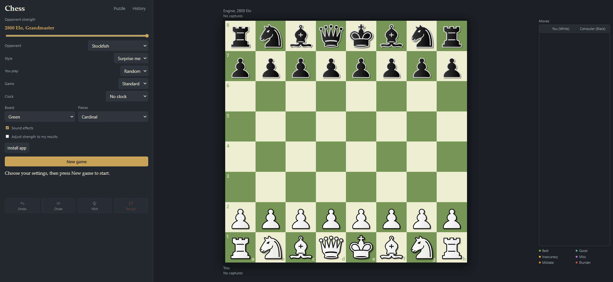
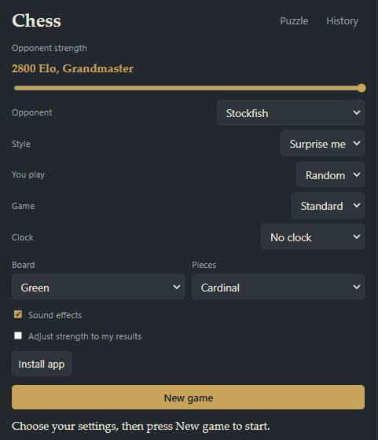
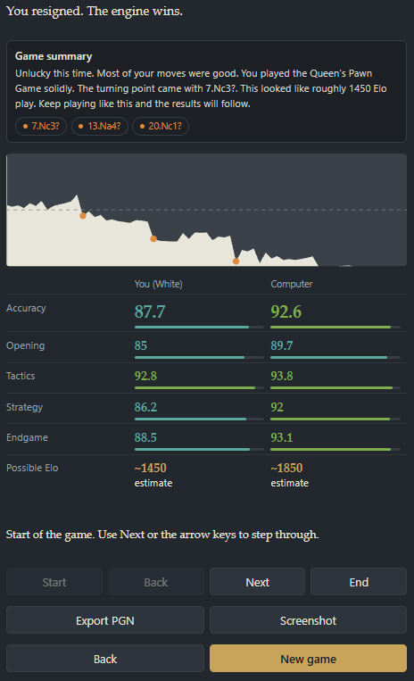

[Chess vs Computer](https://chess.zawaung.site) is a chess site where you play
against an engine that you can tune from beginner to very strong, and that
tries not to feel like a machine. It is a Python (FastAPI) back end with
[Stockfish](https://stockfishchess.org) behind it, in a Docker container behind
the same nginx as everything else on this server.

## Playing

You pick standard chess or Chess960 (a random one of the 960 starting
positions each game), a strength from 400 Elo up to a configurable maximum, and
whether the game is timed. When it finishes you can export the moves as PGN or
save a screenshot of the board. On a phone the layout collapses to the board,
the status line and a few buttons, with settings in a popup.

## Making the engine weaker, on purpose

Below 2500 Elo the app asks the engine for its top candidate moves and picks
among them using a centipawn-loss budget: a weaker setting allows a bigger average drop in
move quality. The tables for this live in one place in `app/main.py`, so making
a level easier or harder is a matter of editing numbers.

For something closer to human play there is an optional second opponent,
[Maia](https://maiachess.com), a neural network trained on human games. It
needs `lc0` and the network files, which the Dockerfile installs on a
best-effort basis: if that fails, the site still works and the Maia choice is
greyed out.

## Feeling human

A lot of small things add up:

- **Style:** balanced, aggressive, solid, trader, or a random pick. Each has a
  name and a preference for different kinds of moves.
- **Time:** in timed games the reply time follows the engine's clock, with the
  odd long think or instant reply, and in some games it becomes "panic-prone"
  and plays faster and sloppier as time runs low.
- **Mood:** it can tilt after a bad run and get careless when far ahead.
- **Resigning:** when it is clearly lost for a couple of moves it may resign or
  offer a draw, and how readily depends on a random temperament per game.
- **Chat:** an occasional remark, and a goodbye at the end.

## Learning from a game

While you play, the server rates each move (best, good, inaccuracy, miss,
mistake, blunder) by asking Stockfish about the position. A "miss" means failing
to punish your opponent's mistake. Afterwards the analysis screen gives:

- a short written summary built from those ratings

- accuracy broken into opening, tactics, strategy and endgame

- a rough "possible Elo" for each side, from the average centipawn loss mapped
  back through the same tables the engine plays by (only a ballpark figure, and
  it needs at least six moves per side)

  

There is also a daily puzzle. The server fetches Lichess's free daily puzzle
once a day and caches it, falling back to a small built-in set if Lichess is
unreachable. Your streak is stored in your browser, so it does not follow you
between devices.

## Running it

It is a Progressive Web App, so it can be installed from the browser menu on a
phone. The container publishes its port on localhost only, and the number of
simultaneous Stockfish processes is capped in the compose file so a busy moment
cannot eat the whole machine. Think time, strength range and the process cap
are all environment settings.
