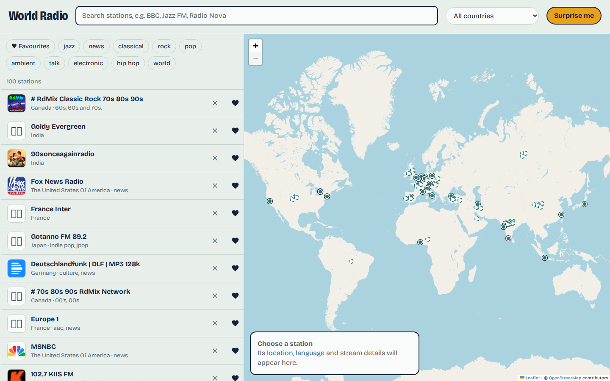

[World Radio](https://worldradio.zawaung.site) lets you search live radio
stations by name, country or genre, see them on a map, and play them. It also
has a "Surprise me" button, favourites, shareable links, now-playing track
titles, and it can be installed as an app.


*Stations on the left, the same stations plotted on the map on the right.*

## Principles

I kept it deliberately plain:

- **No framework and no build step.** The whole front end is one `index.html`
  with its HTML, CSS and JavaScript, plus the Leaflet map library from a CDN.
- **No accounts.** Favourites and stations you remove live in your browser's
  local storage. The server keeps one small JSON file.
- **The browser talks to the directory directly.** The server only does what a
  browser cannot.

```
Search     browser ──► Radio Browser API (community directory)
Audio      browser ──► the station's own HTTPS stream
Map        browser ──► OpenStreetMap tiles
Page       browser ──► host nginx ──► web container
Titles     browser ──► web container ──/api/──► small Node API
```

## The front end

The script is a single `state` object and a `render()` function that rebuilds
the list, the map pins and the player card from it. Rebuilding everything on
each change sounds wasteful, but for a list of 40 to 200 rows it is fast and
far simpler than a virtual DOM.

Some details:

- Searches are debounced, and a request counter throws away out-of-date
  responses so a slow reply cannot overwrite a newer one.
- Browsing with no search text loads popular stations and shuffles them, so the
  list is different each visit.
- Stations without exact coordinates get a pin at the centre of their country,
  nudged by a small offset so pins don't stack. They are drawn as dashed rings
  so you can tell they are approximate.
- A link like `#s=<station id>` selects that station, but does not start
  playing, because browsers require a tap before audio starts.
- On phones the map is never created, so phones download no map tiles.

## What the back end is for

The Node service uses only built-in modules and does two jobs:

**Track titles.** Most stations use the ICY metadata protocol: you ask the
stream for metadata, the station tells you a byte interval N, and after every N
bytes of audio a small block such as `StreamTitle='Artist - Song';` appears. The
server reads just the first block, closes the connection, and returns the
cleaned title. Results are cached for 15 seconds, so many listeners of one
station cost one connection.

**Finding dead stations.** When your browser can't play a station it tells the
server. The server then tests the stream itself and only believes the report if
the test fails, so visitors cannot hide working stations. Confirmed-dead
stations are hidden for everyone for a few days, then re-checked.

## Security, since the server makes outbound requests

A server that fetches addresses on behalf of visitors is a classic
server-side request forgery risk, so it is locked down:

- Clients send a station ID, never a URL; the server looks the URL up itself.
- Only HTTPS is allowed, and a custom DNS lookup refuses private, loopback and
  link-local addresses at connection time, which also defeats DNS rebinding.
- Redirects are re-validated and limited to three, connections time out after
  eight seconds, and at most twelve run at once.
- Stream data is never relayed to the visitor, only a sanitised title.
- The page has a strict Content-Security-Policy, and everything from the
  directory is escaped before it is shown.

## Limits

Only HTTPS, non-HLS streams are listed, because browsers block plain HTTP audio
on an HTTPS page and HLS needs an extra player library. Titles appear only for
stations that send them. And OpenStreetMap's public tile servers are meant for
light use, so heavy traffic would call for a different tile provider.

---

*This web app was developed using [Claude Code](https://claude.com/claude-code).*
